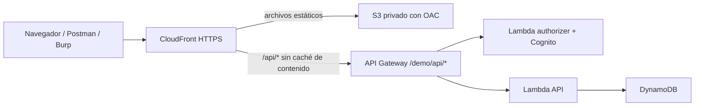

# Kenma Scout · Serverless ≠ Secure

Laboratorio de **Luis Valdivia Humareda** para «Serverless ≠ Secure: Hackeando APIs en AWS con Burp Suite y Montoya API», Burp Suite Day Perú 2026, INICTEL-UNI, 7 de noviembre de 2026 (55 minutos).

Nekoma intenta robar las jugadas de Karasuno. Los usuarios y reportes son ficticios. La API es **intencionalmente vulnerable** y está destinada a una cuenta personal de pruebas. Destruye el despliegue después de grabar. El modo `fixed` sirve para contrastar las correcciones de la charla; no constituye una aplicación de producción.

La PPT y los clips se preparan por separado. Este repo contiene el laboratorio, su infraestructura y la extensión para Burp Suite Community.

## Qué incluye

| Componente | Implementación |
| --- | --- |
| Frontend | HTML, CSS y JavaScript sin CDN ni fuentes externas |
| Local | Node.js, almacenamiento en memoria, JWT HS256 por proceso |
| AWS | SAM, API Gateway REST regional, Lambda Node.js 22, Cognito y DynamoDB |
| Hosting | S3 privado con OAC y una distribución CloudFront para frontend y API |
| Docker | Backend Node y frontend Nginx con proxy `/api/` |
| Burp | Extensión Java con Montoya API, sin Scanner ni funciones Pro |
| Contrato | [OpenAPI](docs/openapi.json) |

## Propósito del proyecto para Burp Suite Day

Este proyecto acompaña la demostración del evento **Burp Suite Day Perú 2026**. Permite seguir un caso completo: reconocer una API desde Burp Proxy, reproducir fallos de autorización en Repeater, automatizar comparaciones con Montoya API y repetir las pruebas después de aplicar las correcciones.

La historia usa una plataforma de scouting de vóley compartida por Nekoma y Karasuno. Cada equipo guarda reportes de jugadas. Un jugador debería consultar únicamente los reportes de su equipo y editar su nombre y biografía; el borrado corresponde al coach. El laboratorio permite comprobar qué ocurre cuando esas restricciones se aplican de forma incorrecta en el backend y en el authorizer.

Encontrarás dos modos de ejecución: `vulnerable`, para reproducir los ataques de la charla, y `fixed`, para verificar que las mismas peticiones dejan de funcionar.

## Backend: la Scouting API

El directorio `backend/` contiene la API que autentica usuarios, consulta perfiles, lista y recupera reportes y procesa su eliminación. Su propósito es concentrar las reglas de acceso y mostrar cómo una identidad válida puede realizar acciones indebidas cuando falta una comprobación de equipo, de rol o de campos editables.

| Archivo | Responsabilidad |
| --- | --- |
| `service.mjs` | Rutas, reglas de negocio y diferencias entre `vulnerable` y `fixed` |
| `auth.mjs` | Autenticación local con JWT y autenticación AWS con Cognito |
| `store.mjs` | Almacenamiento en memoria para local y adaptador de DynamoDB para AWS |
| `seed.mjs` | Usuarios y reportes ficticios iniciales |
| `server.mjs` | Servidor HTTP local que expone la API y los archivos del frontend |
| `lambda.mjs` | Handler de la API y Lambda authorizer para API Gateway |

Las rutas principales son `POST /api/auth/login`, `GET /api/me`, `PATCH /api/me`, `GET /api/reports`, `GET /api/reports/{id}` y `DELETE /api/reports/{id}`. `GET /api/config` permite comprobar el entorno y el modo activo. El contrato completo está en [docs/openapi.json](docs/openapi.json).

Para levantar el backend local, ejecuta `npm ci` y `npm start` desde la raíz, como se detalla más abajo. Para desplegarlo en AWS, instala sus dependencias con `npm ci --prefix backend` y ejecuta `npm run aws:deploy`: la plantilla `template.yaml` crea las Lambdas, API Gateway, Cognito, DynamoDB y el hosting. El despliegue incluido prepara backend y frontend juntos.

Al probarlo encontrarás respuestas JSON, tokens de acceso y reportes identificados como `NEK-001` o `KAR-003`. En local los datos se pierden al reiniciar el proceso; en AWS se guardan en DynamoDB y se restauran mediante los comandos de carga de datos.

## Frontend: la aplicación de scouting

El directorio `frontend/` contiene una aplicación de HTML, CSS y JavaScript sin framework, CDN ni fuentes externas. Su propósito es ofrecer un flujo de uso real que genere tráfico para analizar en Burp: iniciar sesión, abrir reportes y actualizar el perfil.

Al abrirla encontrarás una portada con la identidad de los equipos, el acceso de usuarios, el cuaderno de reportes y el perfil editable. En el entorno local también encontrarás el panel «Laboratorio de API» para restaurar datos y alternar el modo de seguridad. Ese panel no habilita cambios de modo en AWS.

`index.html` define la página, `app.js` controla la interacción y las llamadas HTTP, los archivos CSS definen la apariencia y `config.js` establece la base de la API. Por defecto utiliza `/api`, por lo que frontend y backend comparten origen.

Para verlo localmente, ejecuta `npm start` y abre `http://127.0.0.1:3000`; el servidor Node entrega ambos componentes. Con Docker, el servicio frontend utiliza Nginx y reenvía `/api/*` al backend. Las instrucciones de ambas opciones están más abajo.

Para preparar los archivos estáticos por separado:

```sh
npm run build
```

El resultado queda en `dist/`. En AWS, `npm run aws:deploy` publica ese contenido en S3 privado y lo sirve mediante CloudFront. Después del primer despliegue, publica cambios del frontend con:

```sh
npm run aws:frontend
```

Este comando conserva los datos y la infraestructura. Abre el output `WebsiteUrl` para encontrar la aplicación publicada. Si alojas `dist/` en otro origen, debes configurar `apiBaseUrl` en `frontend/config.js` antes de compilar y permitir ese origen mediante `ALLOWED_ORIGIN` al desplegar la API.

## Extensión: Kenma Scout para Burp Suite

El directorio `extension/` contiene una extensión Java construida con Montoya API para Burp Suite Community. Su propósito es automatizar una comparación acotada de acceso a objetos y preparar peticiones que puedas revisar en Repeater durante la charla.

La extensión se instala dentro de Burp; no se despliega como servidor ni se publica en AWS. Necesitas JDK 21 o superior y un Burp compatible con Montoya API 2026.7. Desde la raíz del proyecto:

```sh
npm run build:extension
npm run test:extension
```

Carga `extension/build/kenma-scout.jar` desde **Extensions → Installed → Add → Java**. Encontrarás una pestaña **Kenma Scout** y un menú contextual del mismo nombre sobre las peticiones compatibles.

Añade el dominio de tu laboratorio al Target Scope y captura un `GET /api/reports/NEK-001` con `Authorization`. Desde el menú contextual puedes:

- **Comparar BOLA:** enviar cuatro GET con la misma identidad y comparar el reporte original con `KAR-001`, `KAR-002` y `KAR-003`.
- **Preparar PATCH:** generar en Repeater una petición para intentar cambiar el rol a `coach`.
- **Preparar DELETE:** generar en Repeater el borrado de `NEK-002`.

Encontrarás una tabla de resultados con estados y tamaños de respuesta. Un doble clic envía la petición correspondiente a Repeater para inspeccionarla. PATCH y DELETE requieren envío manual. Comprueba siempre el equipo y el rol con `/api/me` antes de interpretar una respuesta como acceso indebido. Más abajo se detallan el comportamiento de la extensión y las precauciones de caché para repetir la demostración.

## Ejecución local

Necesitas Node.js 22 o superior. La aplicación local no requiere paquetes externos.

```sh
npm ci
npm test
npm run check
npm start
```

Abre `http://127.0.0.1:3000`. Usuarios: `kenma` (jugador de Nekoma), `kuroo` (coach de Nekoma), `hinata` (jugador de Karasuno), `ukai` (coach de Karasuno). Contraseña local para todos: `DemoVolley2026!`.

El panel «Laboratorio de API» permite reiniciar los datos o cambiar entre `vulnerable` y `fixed`. Reiniciar Node también restaura los datos y genera una nueva clave JWT. Cada login produce un token distinto.

Las variables se leen del entorno del proceso: **`.env` no se carga automáticamente al ejecutar Node**. `.env.example` documenta las variables locales. Ejemplo PowerShell:

```powershell
$env:LAB_MODE = 'fixed'
npm start
```

## Docker

Con Docker Engine o Docker Desktop activo:

```sh
docker compose up --build -d
docker compose ps
```

Puedes ejecutar los mismos siete tests a través de Nginx (restauran los datos locales):

```powershell
$env:LAB_TEST_URL = 'http://127.0.0.1:3000'
npm test
Remove-Item Env:LAB_TEST_URL
```

Abre `http://127.0.0.1:3000`. Compose construye dos imágenes: backend Node y frontend Nginx con sus archivos estáticos incorporados. Nginx reenvía `/api/*` al servicio backend. Los datos viven en memoria; reiniciar el backend los restaura. La configuración por defecto publica únicamente en loopback.

```sh
docker compose restart backend
docker compose down
```

Para el modo corregido, configura `LAB_MODE=fixed` en el entorno o en un archivo `.env` que Docker Compose sí lee, y ejecuta `docker compose up -d --force-recreate`.

También puedes ejecutar la imagen del backend, que incluye el frontend para uso autónomo:

```sh
docker build -t kenma-scout .
docker run --rm -p 127.0.0.1:3000:3000 kenma-scout
```

## Despliegue en AWS

Necesitas AWS CLI v2, SAM CLI, Node.js y un perfil con permisos para CloudFormation, IAM, Lambda, API Gateway, DynamoDB, Cognito, S3, CloudFront y CloudWatch Logs. Los scripts usan por defecto el perfil `luisvaldivia`, región `us-east-1` y stack `kenma-scout-lab`; puedes cambiarlos con `AWS_PROFILE`, `AWS_REGION` y `STACK_NAME`.

```powershell
$env:AWS_PROFILE = 'luisvaldivia'
$env:AWS_REGION = 'us-east-1'
$env:STACK_NAME = 'kenma-scout-lab'
$env:LAB_MODE = 'vulnerable'
aws sts get-caller-identity --profile $env:AWS_PROFILE
npm ci --prefix backend
npm run aws:deploy
```

`aws:deploy` valida la plantilla, empaqueta `backend/` con sus dependencias mediante SAM, despliega el stack, copia `dist/` al bucket privado, invalida CloudFront, carga usuarios/reportes y vacía la caché del authorizer. No necesita `sam build` ni Docker para empaquetar este backend JavaScript. **Cada despliegue restaura los datos del laboratorio.** CloudFront puede tardar varios minutos en quedar listo.

Si SAM no está en PATH, configura `SAM_BIN` con la ruta de su ejecutable. El script también detecta una instalación local en `.tools/sam-env/`. Esa instalación no forma parte del repositorio.

Los outputs se guardan en `.local/deployment.json`; los accesos AWS se generan con una contraseña aleatoria y se guardan en `.local/credentials.json`. Ambos archivos están excluidos de Git. También puedes proporcionar `DEMO_PASSWORD` para controlar esa contraseña. No uses una contraseña real.

```sh
npm run aws:outputs
npm run test:aws
npm run aws:reset
npm run aws:flush-cache
```

Para publicar solo cambios visuales, usa `npm run aws:frontend`: reconstruye los archivos estáticos, sincroniza S3 e invalida CloudFront, sin restaurar datos ni modificar la infraestructura. La identidad visual usa rojo Nekoma, naranja/negro Karasuno y una ilustración vectorial original de los uniformes #5 y #10 en `frontend/battle.svg`.

`test:aws` prueba el frontend, Cognito y las tres vulnerabilidades/correcciones **a través de CloudFront**. Modifica datos ficticios y los restaura al terminar. Usa el mismo perfil, región y stack del despliegue.

`npm run seed:aws` restaura únicamente los datos y accesos, sin invalidar políticas. Evita ejecutar reinicios o invalidaciones en paralelo con los tests: la propagación de la caché del authorizer es asíncrona. Para ver estados HTTP sin imprimir tokens, configura `AWS_TEST_VERBOSE=1`.

Para comparar la versión corregida, establece `LAB_MODE=fixed`, repite `npm run aws:deploy` y ejecuta `npm run test:aws`. Para volver a preparar los ataques, despliega de nuevo `vulnerable`.

### Rutas de CloudFront



`WebsiteUrl` abre la aplicación y `CloudFrontApiUrl` es la base para Postman, Burp y otros clientes. El frontend mantiene `apiBaseUrl: '/api'`, por lo que no requiere cambiar archivos al desplegar. No se usa S3 website hosting público.

CloudFront conserva `Authorization` y admite GET, POST, PATCH, DELETE y OPTIONS hacia API Gateway. La caché de contenido de `/api/*` está desactivada; **la caché vulnerable de 300 segundos pertenece al authorizer de API Gateway**, no a CloudFront. Se usa la política `AllViewerExceptHostHeader` para evitar enviar el Host de CloudFront al endpoint regional de API Gateway. Véase la [documentación de AWS](https://docs.aws.amazon.com/AmazonCloudFront/latest/DeveloperGuide/using-managed-origin-request-policies.html).

El navegador usa el mismo origen para la UI y la API. Postman y Burp pueden usar esa URL con `Authorization: Bearer <token>`; CORS es una restricción de navegadores, no un mecanismo de autenticación. Si alojas el frontend en otro origen, define `ALLOWED_ORIGIN` antes del despliegue. El endpoint regional directo también aparece en `ApiBaseUrl`.

### Destruir después de grabar

```sh
npm run aws:delete
```

El comando obtiene el bucket del stack seleccionado, vacía **ese bucket de frontend** y ejecuta `sam delete --no-prompts`. Elimina API, distribución, bucket, tablas, usuarios y logs definidos por el stack. El bucket de empaquetado administrado por SAM puede ser compartido con otros stacks y no se elimina como recurso propio de esta demo. Comprueba la eliminación con `aws cloudformation describe-stacks --stack-name kenma-scout-lab --profile luisvaldivia --region us-east-1` (debe indicar que el stack no existe).

## Vulnerabilidades intencionales

| Caso | Modo vulnerable | Modo fixed |
| --- | --- | --- |
| BOLA | `GET /reports/KAR-003` revela la jugada a Kenma | Se comprueba el equipo en cada acceso |
| Mass assignment | `PATCH /me` acepta `role` y `team` del cliente | Solo permite `name` y `bio` |
| Authorizer cache | Política wildcard y TTL 300 s por token: un GET puede autorizar DELETE | TTL 0, ARN específico y autorización adicional en dominio |

La lista `/reports` siempre filtra por equipo: el acceso indebido se demuestra cambiando un ID. Para distinguir mass assignment de la caché, comprueba el rol mediante `/me` y prueba con caché fría. El modo `fixed` también valida pertenencia al borrar.

La simulación local reproduce tanto Allow como Deny cacheados. Un DELETE inicial de Kenma genera Deny para todos los métodos durante 300 s; ese token tampoco podrá hacer GET hasta vaciar la caché. La UI ejecuta GET al cargar y por eso calienta la caché. En AWS usa un token nuevo para garantizar una entrada fría. `aws:flush-cache` invalida las políticas del stage, pero su propagación no es inmediata; `aws:reset` restaura también los datos. Los endpoints `/lab/reset` y `/lab/mode` solo existen en local.

## Extensión Montoya para Burp Community

Necesitas JDK 21 o superior y una versión de Burp compatible con Montoya API 2026.7. La compilación inicial descarga únicamente la API oficial de Maven Central y verifica un SHA-256 fijado. Después puede compilar sin red si conserva `extension/lib/`.

```sh
npm run build:extension
npm run test:extension
```

En Burp: **Extensions → Installed → Add → Java**, selecciona `extension/build/kenma-scout.jar`. Se incorpora la pestaña «Kenma Scout». Sigue el modelo de extensión de la [documentación oficial de PortSwigger](https://portswigger.net/burp/documentation/desktop/extend-burp/extensions/creating/first-extension).

Añade la URL del laboratorio al Target Scope. Sobre un `GET /api/reports/NEK-001` autenticado (o `/demo/api/reports/NEK-001` directo), abre el menú contextual **Kenma Scout**:

- **Comparar BOLA:** envía 4 GET secuenciales con la misma identidad: el objeto original y `KAR-001` a `KAR-003`. Muestra estado, tamaño y una lectura de la respuesta. Confirma `/me` antes de interpretar el acceso como BOLA; la extensión no declara un hallazgo automático.
- **Preparar PATCH:** coloca `role=coach` en Repeater para enviarlo manualmente.
- **Preparar DELETE:** coloca el borrado de `NEK-002` en Repeater para enviarlo manualmente.

La comparación comprueba el scope antes de cada envío y calienta la caché del authorizer. Un doble clic en una fila envía su petición a Repeater. La extensión no guarda tokens ni evidencia en disco y no usa Scanner, Intruder ni proyectos guardados. El JAR contiene solo las clases de la extensión: Burp proporciona Montoya en ejecución.

## Estructura

```text
backend/       Dominio, autenticación, almacenamiento y adaptadores local/Lambda
frontend/      Aplicación estática, sin dependencias externas
extension/     Código Java de la extensión Montoya
docker/        Proxy Nginx para Docker Compose
docs/          Contrato OpenAPI
scripts/       Build, despliegue, carga de datos y comprobaciones AWS
tests/         Pruebas locales de autenticación y vulnerabilidades/correcciones
template.yaml  Infraestructura SAM/CloudFormation
```

No incluye PPT, videos ni contenido oficial de Haikyuu!!. Los personajes y equipos se usan como referencia narrativa; el código no incluye imágenes del anime. El nombre y las marcas de Burp Suite pertenecen a PortSwigger. La licencia del código está en [LICENSE](LICENSE).
